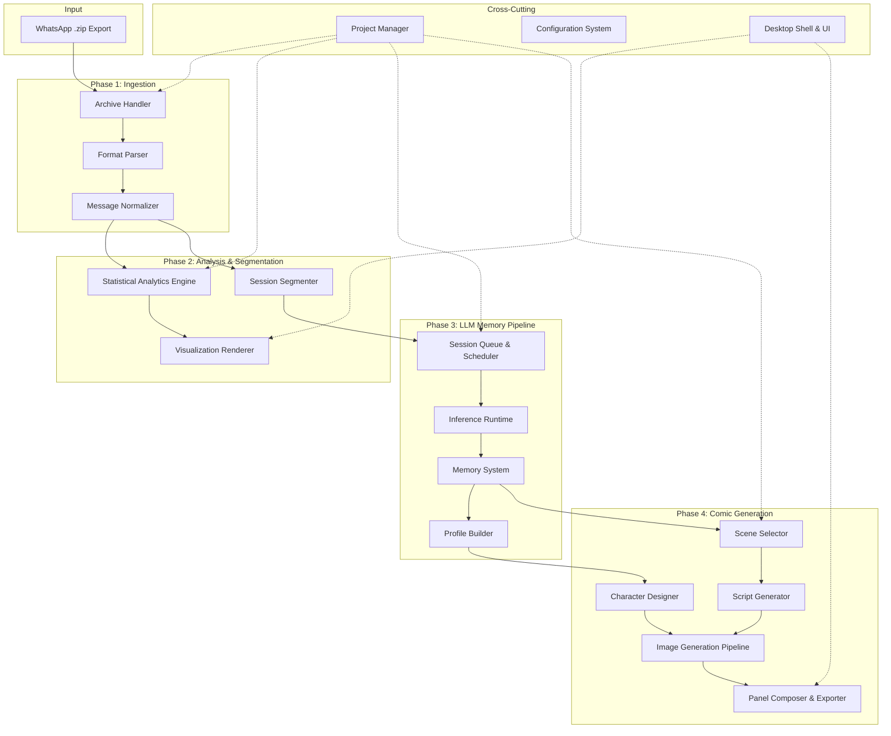
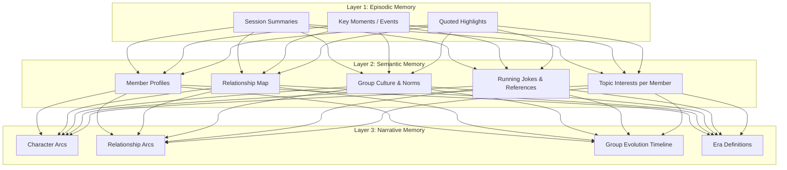
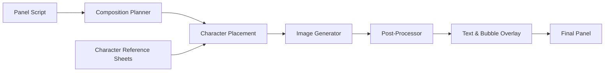
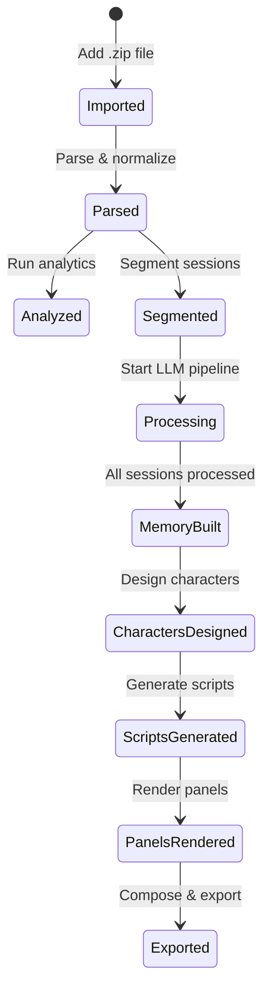
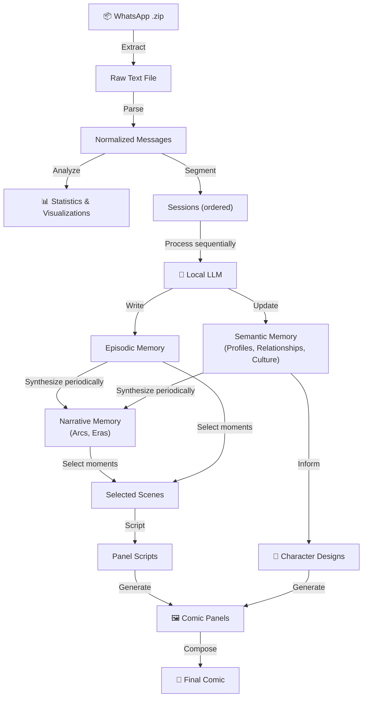
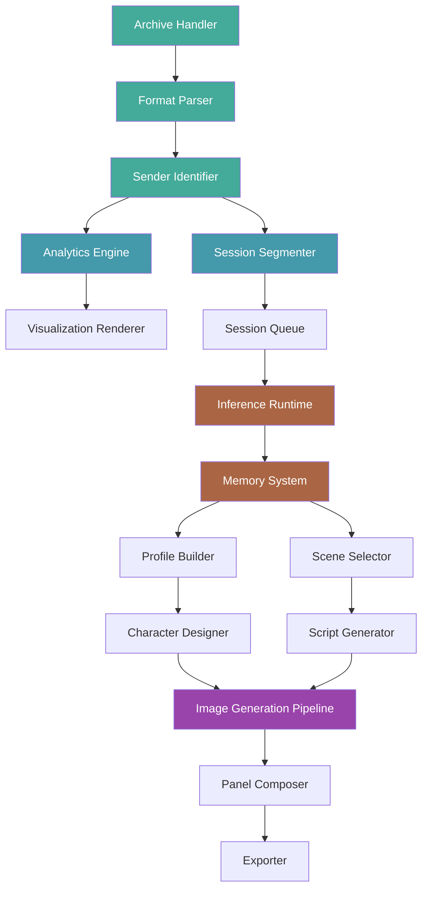

# Yapbook — System Architecture

> *Turn chat histories into comic-book memories.*

---

## System Overview



---

## Phase 1 — Ingestion & Parsing

This is the foundation. Everything downstream depends on a clean, normalized data model coming out of this phase. v1 is **text-only** — no media extraction or processing.

### 1.1 Archive Handler

**What it does:** Accepts a `.zip` file, validates it, and extracts the `.txt` chat export file.

**Key concerns:**
- WhatsApp exports vary by platform (iOS vs Android) and locale — the directory structure inside the zip is not identical
- v1 scope: extract only the `.txt` file, ignore any media files in the archive
- Must handle corrupt or partial zips gracefully

**Outputs:** Extracted text file for parsing.

### 1.2 Format Parser

**What it does:** Parses the raw WhatsApp `.txt` chat export into structured message objects.

**Key concerns:**
- WhatsApp's export format is **not standardized**. It varies by:
  - **OS** (iOS: `[DD/MM/YY, HH:MM:SS]` vs Android: `DD/MM/YY, HH:MM -`)
  - **Locale** (date format changes based on phone language/region)
  - **WhatsApp version** (format has shifted over the years)
- Multi-line messages: a single message can span multiple lines. The parser must not treat continuation lines as new messages
- System messages (group created, member added/removed, encryption notice, missed calls) need to be parsed as a distinct type — they're structurally important metadata, not conversation
- Deleted messages (`This message was deleted`, `You deleted this message`) need flagging
- Media omission markers (`<Media omitted>`) are flagged as type `media_omitted` but not resolved

**Data model per message:**

| Field | Description |
|-------|-------------|
| `id` | Sequential message index |
| `timestamp` | Parsed datetime (UTC-normalized) |
| `sender` | Sender name (stable across export) |
| `content` | Raw message text |
| `type` | `text` · `system` · `deleted` · `link` · `media_omitted` |
| `reply_to` | Reference to quoted message, if detectable |

### 1.3 Sender Identification

**What it does:** Identifies the set of unique senders in the chat.

**Key concerns:**
- WhatsApp snapshots all contact names **at export time**, so each sender has a consistent name throughout the entire export. No alias merging is needed.
- The only edge case is the **exporter's own messages**, which may appear without a name prefix or with a phone number depending on platform/version. This is a single mapping the user confirms at import time.
- Build a `Member` entity with a canonical name for each unique sender.

---

## Phase 2 — Analysis & Segmentation

Two parallel tracks: statistical analytics for the user, and session segmentation for the LLM pipeline.

### 2.1 Statistical Analytics Engine

**What it does:** Computes quantitative metrics across the entire chat history.

**Core metrics:**

| Category | Metrics |
|----------|---------|
| **Volume** | Total messages, messages per member, messages per day/week/month/year |
| **Temporal** | Activity heatmap (hour × day-of-week), busiest periods, dead periods, chat lifespan |
| **Behavioral** | Average response time per member, conversation initiation rate, who-replies-to-whom matrix |
| **Content** | Most used words/phrases per member, emoji frequency, link sharing rate |
| **Social** | Reply chains (who talks to whom most), mention frequency, who gets ignored most, who revives dead chats |
| **Engagement** | Message length distribution per member, one-word-reply rate, monologue frequency |
| **Milestones** | First message, 10K/50K/100K message marks, longest conversation streak, longest silence |

**Design consideration:** This engine should be built as a pipeline of independent metric calculators. Each one takes the normalized message list and outputs a result. This makes it easy to add new metrics without touching existing ones.

### 2.2 Visualization Renderer

**What it does:** Turns computed metrics into interactive charts and visual summaries.

**Key visualizations:**
- Activity timeline (sparkline or area chart across the chat's lifetime)
- Member contribution pie/bar chart
- Hour-of-day × day-of-week heatmap
- Reply network graph (directed, weighted)
- Word clouds per member
- Emoji leaderboards
- "On this day" snapshots

**Design consideration:** Visualizations should be renderable both within the desktop app and as exportable images/PDFs for sharing.

### 2.3 Session Segmenter

This is a **critical bridge** between Phase 2 and Phase 3. The quality of session boundaries directly impacts how well the LLM can build coherent memories.

**What it does:** Breaks the continuous message stream into discrete "sessions" — coherent conversational episodes.

**Segmentation strategies (layered, not mutually exclusive):**

1. **Inactivity gap:** If there's a gap of N minutes (tunable, default ~30–60 min) between messages, break. This is the simplest and most reliable baseline.

2. **Time-of-day boundaries:** Natural breaks at sleep hours. A message at 2 AM after silence since 11 PM might start a new session even if the gap is short.

3. **Topic drift detection:** Using lightweight NLP (TF-IDF similarity, embedding cosine distance) to detect when the conversation topic shifts significantly within a continuous stream.

4. **Participant shift:** If the set of active participants changes significantly (e.g., a 1-on-1 conversation within a group chat suddenly becomes a group-wide discussion).

5. **System event boundaries:** "Member X added Member Y" or similar events are natural session boundaries.

**Session metadata to compute:**

| Field | Description |
|-------|-------------|
| `session_id` | Unique identifier |
| `start_time` | Timestamp of first message |
| `end_time` | Timestamp of last message |
| `duration` | Wall-clock duration |
| `message_count` | Number of messages |
| `participants` | Set of active members |
| `dominant_speaker` | Member with most messages |
| `topic_keywords` | Extracted topic indicators |
| `sentiment_signal` | Overall emotional tone (positive/negative/neutral/mixed) |
| `intensity` | How rapid-fire the conversation is (messages per minute) |

**Session scoring:** Not all sessions are equally interesting. Assign an **"interestingness" score** based on:
- Participant count (more people = potentially more dynamic)
- Message density (rapid exchanges suggest engagement)
- Sentiment variance (emotional range within the session)
- Message length variance (suggests both quick banter and longer stories)

This score helps prioritize which sessions to focus on for comic generation later.

---

## Phase 3 — LLM Context & Memory Pipeline

This is the hardest engineering problem in the system. You're essentially building a **long-term memory agent** that processes hundreds of thousands of messages sequentially and builds an evolving understanding of a social group.

### 3.1 Session Processing Queue

**What it does:** Feeds sessions to the LLM in chronological order, managing the throughput and state.

**Key concerns:**
- Sessions must be processed **in order** — the memory system depends on temporal sequence
- Need checkpoint/resume capability — processing 100K+ messages will take hours/days. The user must be able to pause, close the app, and resume
- Progress tracking with estimated time remaining
- Error recovery: if a session fails (LLM crash, OOM), retry with smaller context or skip and flag

**Queue states per session:** `pending` → `processing` → `completed` | `failed` | `skipped`

### 3.2 Inference Runtime Abstraction

**What it does:** Provides a unified interface to the LLM, whether running locally or via cloud API.

**Backends to support:**

| Backend | Use Case |
|---------|----------|
| **Local (primary)** | Privacy-first. Run quantized models via ollama, llama.cpp, or similar |
| **Cloud (optional)** | For users who want faster processing or higher quality. OpenAI, Anthropic, Gemini APIs |

**Key design decisions:**
- Abstract behind a simple interface: `processSession(session, memoryContext) → memoryUpdates`
- Handle context window limits: if a session is too large for the model's context, split it into sub-sessions with overlap
- Rate limiting and cost tracking for cloud backends
- Model selection: let the user choose which model to use, with recommendations based on their hardware

### 3.3 Memory System

This is the **architectural centerpiece**. The memory system must support:

1. **Incremental construction** — knowledge builds over time, never reprocessed from scratch
2. **Temporal awareness** — the system knows *when* it learned something and can track evolution
3. **Multi-layered abstraction** — from raw session observations to high-level character understanding

#### Memory Architecture — Three Layers



#### Layer 1 — Episodic Memory (per session)

After processing each session, the LLM produces:

- **Session summary:** 2-3 sentence description of what happened
- **Key events:** Specific notable moments (someone announced news, a fight happened, someone shared something vulnerable, a hilarious exchange)
- **Emotional tone:** The prevailing mood and any shifts
- **Interaction patterns:** Who talked to whom, any sub-conversations
- **Quoted highlights:** Verbatim quotes that are particularly funny, meaningful, or character-defining

This is the **raw material** that higher layers synthesize from.

#### Layer 2 — Semantic Memory (accumulated, evolving)

This is the **working knowledge** about the group. It evolves with every session processed.

**Member Profiles:**

Each member gets a living profile document that the LLM updates incrementally:

```
Member: Priyanshu
Communication Style: Tends to write long messages when passionate about a
                     topic. Heavy emoji user.
Personality Traits:
  - Humor style: Dry, observational (confidence: high, based on 45+ sessions)
  - Conflict style: Avoidant early on, became more direct after [Event X]
  - Role in group: The planner — initiates meetup discussions 70% of the time
Interests: Photography, indie music, cooking
Key Life Events:
  - [2023-03] Started new job at [Company] — mood shifted noticeably more positive
  - [2023-08] Breakup period — less active for ~3 weeks, others checked in
Evolution Notes:
  - Early period (2022): Mostly lurker, short responses
  - Middle period (2023): Became most active member
  - Recent (2024): Balanced, quality over quantity in messages
```

> [!IMPORTANT]
> **Profiles are not static snapshots.** They must track *how* a person's behavior and role changes over time. This is what makes the output feel real — people are not one-dimensional.

**Relationship Map:**

A weighted, directed graph of member-to-member dynamics:

| Relationship | Properties |
|-------------|------------|
| A ↔ B | Closeness score, interaction frequency, shared interests, conflict history, inside jokes between them, communication pattern (do they reply to each other fast? do they @ each other?) |

**Group Culture:**

- Inside jokes and their origin stories
- Recurring topics and rituals ("Sunday movie poll", "Monday motivation memes")
- Communication norms (is the group sarcastic? Supportive? Competitive?)
- Shared references (shows, songs, events they all know)
- Group vocabulary (made-up words, nicknames for things)

#### Layer 3 — Narrative Memory (periodic synthesis)

This layer doesn't update every session. It's synthesized periodically (e.g., every 50–100 sessions, or when triggered by significant events).

- **Character Arcs:** How each member's story progresses — their growth, struggles, triumphs as visible through the chat
- **Relationship Arcs:** How key relationships evolved — friendships that deepened, conflicts that resolved, duos that drifted apart
- **Group Evolution:** The macro story of the group — when it was most alive, periods of dormancy, what brought people back
- **Era Definitions:** Natural "chapters" of the group's history, each with a mood, key events, and defining characteristics

#### Memory Storage Format

Memories need to be stored as **structured files on disk**, not just in LLM context:

- Each memory type gets its own file/directory
- Files use a human-readable format (Markdown or YAML) so users can inspect and edit them
- Every memory update is timestamped and linked to the session that produced it
- Version history is maintained — you can see how a profile evolved over time

This file-based approach means:
- The LLM receives relevant memory files as context when processing each session
- After processing, it outputs structured updates that are merged back into the files
- Memory files can be backed up, shared, or manually corrected by the user

#### Memory Retrieval for Session Processing

When processing session N, the LLM needs context. But you can't feed it *all* accumulated memory — it would overflow the context window.

**Retrieval strategy:**
1. **Always include:** Current member profiles (compressed), relationship map summary, group culture document
2. **Recent episodic:** Last 3-5 session summaries for continuity
3. **Relevant episodic:** Sessions that share participants or topics with the current session (use embedding similarity)
4. **Narrative context:** Current era definition and active character/relationship arcs

Budget this to fit within ~30-40% of the model's context window, leaving the rest for the actual session messages and output.

### 3.4 Prompt Architecture

The LLM needs carefully designed prompts for each task:

| Prompt Type | Purpose |
|-------------|---------|
| **Session Analyzer** | Process a session and extract episodic memories |
| **Profile Updater** | Given new observations, update a member's profile |
| **Relationship Updater** | Update relationship dynamics based on interactions |
| **Culture Detector** | Identify new inside jokes, norms, shared references |
| **Narrative Synthesizer** | Periodically synthesize higher-level arcs and eras |
| **Moment Scorer** | Rate moments for "comic-worthiness" |

Each prompt is a separate, testable, iterable unit. Don't try to do everything in one mega-prompt.

### 3.5 Quality & Consistency Safeguards

- **Hallucination guardrails:** The LLM should only make claims grounded in actual messages. Prompt engineering should enforce "cite your evidence" patterns
- **Confidence tracking:** Each personality trait, relationship assessment, etc. should have a confidence level based on how much evidence supports it
- **Contradiction detection:** If a new observation contradicts established memory, flag it for resolution rather than silently overwriting
- **Bias awareness:** The LLM might over-index on dramatic or negative events. Balance mechanisms needed

---

## Phase 4 — Comic Generation Pipeline

### 4.1 Scene Selector

**What it does:** Chooses which moments from the chat history to turn into comic panels.

**Selection criteria:**
- Moment interestingness score (from session scoring)
- Narrative significance (key events from the narrative memory layer)
- Emotional variety (don't make 10 panels that are all arguments)
- Member coverage (ensure everyone gets featured)
- Temporal spread (cover different eras of the group)

**Selection modes:**
- **Automatic:** System picks the best N moments
- **Curated:** User browses moments and selects favorites
- **Thematic:** Generate a comic around a theme ("The camping trip", "Finals week", "The great debate of 2023")

### 4.2 Character Design System

**What it does:** Creates and maintains consistent visual representations of each group member.

**Components:**

1. **Profile-to-Character Mapper:** Uses member profiles (personality traits, communication style, role in group) to suggest character design directions. The "planner" might get a clipboard or organized look; the "chaotic one" might have wilder styling.

2. **Character Sheet Generator:** For each member, produce a reference sheet showing:
   - Front/side/back views
   - Key expressions (happy, angry, surprised, scheming)
   - Signature poses or gestures
   - Distinctive visual elements (accessories, hairstyle, clothing style)

3. **Style System:** Define the overall art style for the comic:
   - Chibi / cartoon / semi-realistic / manga / western comic
   - Color palette
   - Line weight and texture
   - Level of detail

4. **User Customization:** Let users adjust character designs — upload reference photos, tweak features, approve/reject generated designs

> [!NOTE]
> Character consistency across panels is one of the hardest problems in AI image generation today. This will likely require specialized techniques — see §4.4.

### 4.3 Script Generator

**What it does:** Takes a selected moment and produces a comic script — panel-by-panel breakdown with dialogue, action descriptions, and visual direction.

**Script format per panel:**

```yaml
panel:
  number: 3
  layout: wide  # wide | tall | square | splash
  scene: "Living room, evening, warm lighting"
  characters:
    - name: Priyanshu
      position: left
      expression: laughing
      action: "leaning back in chair, phone in hand"
    - name: Arjun
      position: right
      expression: deadpan
      action: "arms crossed, one eyebrow raised"
  dialogue:
    - speaker: Priyanshu
      text: "BRO I just realized we've been arguing about this for THREE HOURS"
      style: excited
    - speaker: Arjun
      text: "And you're still wrong."
      style: dry
  narration: null
  sfx: null
  mood: comedic
  camera: medium shot
```

**Key concerns:**
- Dialogue should be adapted from actual chat messages, not invented
- The LLM should use narrative memory to inform *how* characters are portrayed
- Pacing: vary panel sizes and types for rhythm (quick exchanges = small panels, dramatic moments = splash pages)
- Cultural and language authenticity: preserve code-switching, slang, in-jokes

### 4.4 Image Generation Pipeline

**What it does:** Turns scripts into actual comic panel images.

**Architecture:**



**Character Consistency Techniques:**
- **Reference-conditioned generation:** IP-Adapter, PhotoMaker, or InstantID-style approaches that take character reference images as conditioning input
- **LoRA fine-tuning:** Train per-character LoRAs on generated character sheets for strong consistency (heavier but more reliable)
- **Inpainting workflows:** Generate scene first, then inpaint characters using references
- **Pose conditioning:** Use ControlNet with pose skeletons to ensure characters are in the right positions

**Background & Scene Generation:**
- Generate backgrounds separately from characters for compositing flexibility
- Build a library of reusable scene templates (bedroom, café, park, classroom)
- Style transfer to ensure backgrounds match character art style

**Local vs Cloud:**
- Local: Stable Diffusion / SDXL / Flux via ComfyUI or similar
- Cloud: DALL-E, Midjourney API, Flux Pro (future option)
- Same abstraction pattern as the LLM runtime

### 4.5 Panel Composer & Exporter

**What it does:** Assembles individual panel images into comic pages and exports them.

**Layout engine:**
- Comic page templates with varying grid layouts (2×2, 3×2, full-width + small panels, etc.)
- Gutter spacing, panel borders, page margins
- Speech bubble placement and tail direction
- Sound effects and narration box placement
- Page flow (left-to-right for western, right-to-left option for manga style)

**Export formats:**
- **PDF:** Print-ready comic book
- **Image sequence:** Individual pages as PNG/JPG
- **Web format:** Scrollable vertical strip (webtoon style)
- **Animated:** Simple panel-by-panel animation with transitions (stretch goal)

---

## Cross-Cutting Components

### 5.1 Project Manager

Every Yapbook session is a **project** — a self-contained workspace with all data, processed results, and generated outputs.

**Project structure on disk:**

```
yapbook-project/
├── project.yaml              # Project metadata, settings, state
├── source/
│   ├── raw/                   # Original zip contents
│   └── parsed/                # Normalized message database
├── analytics/
│   ├── metrics.json           # Computed statistics
│   └── visualizations/        # Generated charts
├── sessions/
│   ├── index.json             # Session list with metadata
│   └── [session-id]/          # Per-session data
├── memory/
│   ├── episodic/              # Session summaries and events
│   ├── profiles/              # Member profile documents
│   ├── relationships/         # Relationship map
│   ├── culture/               # Group culture document
│   └── narrative/             # Arcs and era definitions
├── characters/
│   ├── [member-id]/           # Character designs per member
│   └── style.yaml             # Art style definition
├── comics/
│   ├── scripts/               # Generated panel scripts
│   ├── panels/                # Individual panel images
│   └── exports/               # Final exported comics
└── checkpoints/               # Processing state for resume capability
```

### 5.2 Pipeline Orchestrator

**What it does:** Manages the end-to-end flow from import to export, tracking which phases are complete and what can run next.

**State machine:**



Each state is persistent. The user can close the app at any point and resume from where they left off.

### 5.3 Desktop Application Shell

**Core UI screens:**

| Screen | Purpose |
|--------|---------|
| **Home / Projects** | Create new project, open existing, see recent projects |
| **Import** | Add zip file, preview contents, confirm sender identity |
| **Analytics Dashboard** | Interactive charts and statistics |
| **Memory Explorer** | Browse and edit accumulated memories, profiles, relationships |
| **Session Browser** | View individual sessions, their summaries, and key moments |
| **Character Studio** | Design, customize, and approve character appearances |
| **Comic Workshop** | Select moments, arrange panels, preview and generate comics |
| **Export** | Choose format and export final comics |
| **Settings** | Model selection, processing preferences, privacy options |

### 5.4 Configuration System

- **Processing config:** Session segmentation thresholds, LLM model selection, inference parameters (temperature, etc.)
- **Privacy config:** What stays local vs. what can be sent to cloud, data retention policies
- **Style config:** Art style, comic format, panel preferences
- **Performance config:** Batch sizes, parallelism, GPU allocation

---

## Data Flow Summary



---

## Open Design Questions

These are decisions that will significantly shape the implementation:

### Memory System
1. **File format for memory storage** — Markdown (human-readable, easy to diff) vs. structured JSON/YAML (easier to parse programmatically) vs. SQLite (queryable)?
2. **Memory retrieval** — Simple file loading vs. vector embeddings for semantic search over past sessions?
3. **Profile evolution tracking** — Append-only log vs. versioned snapshots vs. git-style diffs?

### LLM Pipeline
4. **Model size tradeoff** — Smaller models (7B) process faster but produce shallower analysis. Larger models (70B+) are better but need serious hardware. Where's the sweet spot?
5. **Multi-model pipeline** — Use a small model for routine session summarization and a larger one for periodic deep synthesis?
6. **Structured output** — How strictly should we enforce output schema? JSON mode vs. free-form with post-parsing?

### Comic Generation
7. **Character consistency method** — LoRA per character (high quality, slow setup) vs. IP-Adapter (faster, less consistent) vs. hybrid?
8. **Generation locality** — Can we realistically run image generation locally, or will most users need cloud? What's the minimum hardware?
9. **Art style** — One fixed style or user-selectable? Custom style training?

### Product
10. **Multi-source support** — WhatsApp first, but the architecture should probably anticipate Telegram, Discord, Instagram DMs, iMessage. How abstract should the parser be from day one?
11. **Collaborative mode** — Can multiple friends contribute their exports of the same chat (different perspectives, more complete history)?
12. **Privacy model** — How do you handle consent when group members haven't agreed to have their messages analyzed?

---

## Component Dependency Map

This shows which components must be built before others:



**Suggested build order:**
1. 🟢 **Foundation:** Archive Handler → Format Parser → Sender Identifier
2. 🔵 **Analysis:** Analytics Engine + Session Segmenter (can parallelize)
3. 🟠 **LLM Pipeline:** Inference Runtime → Memory System → Profile Builder
4. 🟣 **Generation:** Character Designer → Script Generator → Image Pipeline → Composer

The Desktop Shell and Project Manager are built incrementally alongside these phases — start with a minimal shell and add screens as backend capabilities come online.
