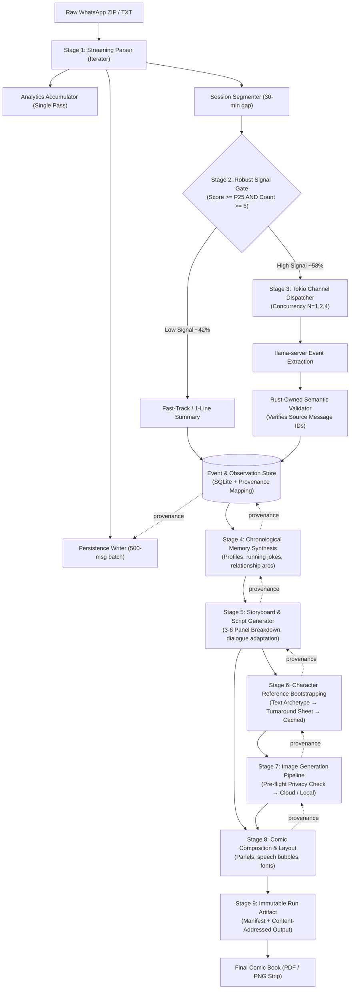
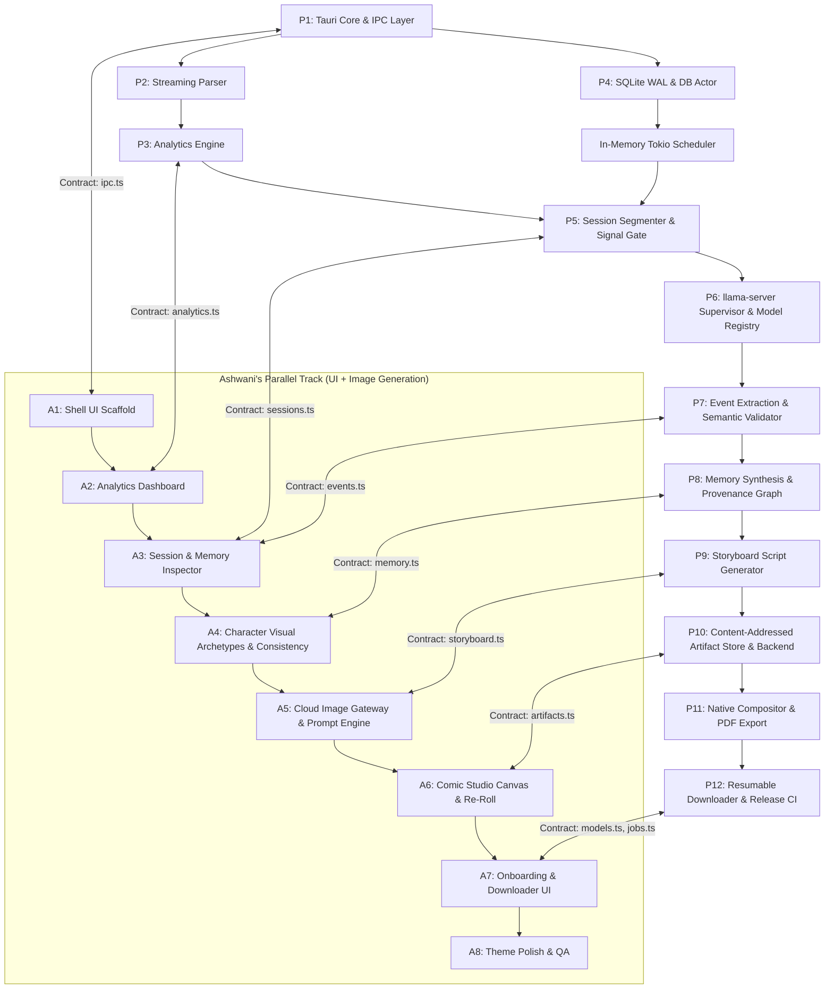

# Yapbook — System Architecture

> _Turn chat histories into comic-book memories._
>
> This is a **living document**. It describes our current best understanding of how Yapbook is structured and why. Sections will evolve as implementation reveals new constraints and opportunities.

---

## Glossary

These terms have precise meanings throughout the documentation. Use them consistently.

| Term              | Definition                                                                                                                                                         |
| :---------------- | :----------------------------------------------------------------------------------------------------------------------------------------------------------------- |
| **Message**       | A single parsed line from the WhatsApp export — one sender, one timestamp, one content body.                                                                       |
| **Session**       | A contiguous burst of messages bounded by a 30-minute inactivity gap. The atomic unit of LLM processing.                                                           |
| **Observation**   | A raw factual note extracted from a session (e.g. "Priyanshu suggested Manali trip").                                                                              |
| **Event**         | A validated, narrative-worthy moment synthesized from one or more observations. Carries provenance links to source messages.                                       |
| **Memory**        | An evolving profile document — member personalities, running jokes, group culture — built incrementally from events over time.                                     |
| **Storyboard**    | A structured 3–6 panel comic script generated from selected events, with scene descriptions, character placements, and dialogue.                                   |
| **Panel**         | One frame of a comic strip — a rendered image with speech bubbles and composition metadata.                                                                        |
| **Run**           | A complete pipeline execution from ingestion through comic output, isolated under a project and uniquely identified.                                               |
| **Provenance**    | The traceable chain linking any artifact (event, memory, panel) back to the specific source messages that substantiated it.                                        |
| **ModelManifest** | A configuration entry defining an LLM model — name, file hash, context window, recommended GPU offload. Swapping models means updating the manifest, not the code. |

---

## 1. System Overview & Core Invariants

Yapbook is a **local AI data-processing pipeline wrapped in a desktop shell**. The UI does not perform heavy computation; it controls a pipeline of streaming ingestion, persistence, inference supervision, event extraction, memory synthesis, storyboard generation, image rendering, and composition.

### The Cardinal Rule

> **Rust owns durable truth and orchestration. Workers perform computation. React owns presentation and interaction.**

Rust tracks pipeline state, job durability, process lifecycles, and artifact provenance. Workers (`llama-server`, Python diffusion workers, or cloud image APIs) are treated as stateless execution units that consume structured inputs and return structured outputs. React renders what Rust tells it to render and sends user intent back over IPC.

### Pipeline Data Flow

```
MESSAGES ──► OBSERVATIONS ──► EVENTS ──► MEMORY ──► STORYBOARDS ──► PANELS ──► IMAGES ──► COMIC
   ▲              ▲              ▲          ▲            ▲              ▲          ▲
   │              │              │          │            │              │          │
   └──────────────┴──────────────┴────── PROVENANCE TRACEBACK ─────────┴──────────┘
```

Every downstream artifact carries provenance links back to the source messages that substantiated it. The model proposes evidence; the application establishes evidence.

---

## 2. Architecture Topology

```mermaid
graph TB
    subgraph UI ["Desktop UI (React 19 + TypeScript Webview)"]
        CANVAS["Comic Canvas & Studio"]
        ANALYTICS["Analytics & Heatmaps"]
        INSPECTOR["Run & Session Inspector"]
        PROGRESS["Pipeline Progress (Real-time IPC)"]
    end

    subgraph CORE ["Rust Native Core (Tokio Async Runtime)"]
        IPC["Tauri Typed IPC Layer"]
        SCHED["Tokio Channel Scheduler (mpsc)"]
        DB_ACTOR["Database Writer Actor"]
        SUP["Process Supervisor (Job Objects / PGID)"]
        CAP["Hardware Capability Detector"]
        ART["Artifact & Provenance Manager"]
        REGISTRY["Model & Prompt Registry"]
    end

    subgraph PERSISTENCE ["SQLite WAL (app.db)"]
        JOBS["Jobs & Checkpoints (Durable Truth)"]
        DATA["Messages, Sessions, Events"]
        META["Projects, Runs, Models, Schemas"]
    end

    subgraph STORAGE ["Local Filesystem Store"]
        OBJECTS["Content-Addressed Objects (sha256)"]
        RUN_DIR["Run Manifests (runs/run-xxx/)"]
        MODELS["Model Cache (GGUF Files)"]
    end

    subgraph WORKERS ["Managed Inference Workers"]
        LLM["llama-server (llama.cpp C++ Sidecar)<br/>GGUF Model with Configurable Slots"]
        CLOUD["Cloud Image API Gateway<br/>(fal.ai / Replicate Flux) with Anonymizer"]
        IMAGE["Optional Local Image Worker<br/>(Headless Python / ComfyUI Sidecar)"]
    end

    UI <-->|Tauri IPC (Typed Interfaces)| IPC
    IPC --> SCHED
    IPC --> INSPECTOR

    SCHED <--> DB_ACTOR
    DB_ACTOR --> PERSISTENCE
    INSPECTOR -.->|Read Connections| PERSISTENCE

    SCHED --> SUP
    SUP --> LLM
    SUP --> IMAGE
    CAP --> SUP
    REGISTRY --> SUP

    SCHED <--> ART
    ART --> OBJECTS
    ART --> RUN_DIR

    SCHED --> CLOUD
    SCHED -.->|Real-time Events| PROGRESS
```

---

## 3. Technology Decisions

These are the foundational choices. Each was made once so that every downstream decision inherits from them.

| Layer             | Technology                                          | Why This Over Alternatives                                                                                                                                                                        |
| :---------------- | :-------------------------------------------------- | :------------------------------------------------------------------------------------------------------------------------------------------------------------------------------------------------ |
| **Desktop Shell** | **Tauri v2**                                        | ~20 MB binary, ~60 MB RAM. Native OS Webviews. Strict capability-based IPC — critical for private chat data. Electron would be 150 MB+ and lack the security model.                               |
| **Frontend**      | **React 19 + TypeScript + Vite + TailwindCSS**      | High dev velocity, component ecosystem, instant hot-module reload. Chart.js for analytics, HTML5 Web Canvas for interactive comic layouts.                                                        |
| **Contracts**     | **Developer-Authored TypeScript & Rust Interfaces** | Single source of truth across the frontend/backend boundary. No codegen — types are maintained manually by both developers.                                                                       |
| **Core Engine**   | **Rust** (`tokio`, `rusqlite`, `reqwest`, `serde`)  | Native OS supervision, streaming file I/O, SQLite transactions, child process supervision, GPU lifecycle, and hardware detection. The only language that gives us all of these without a runtime. |
| **Persistence**   | **SQLite (WAL Mode) via `rusqlite`**                | Single-file durable database. **Single Database Writer Actor** + independent read connections to eliminate `SQLITE_BUSY` lock contention.                                                         |
| **Storage**       | **Content-Addressed File Store (`artifacts/`)**     | Deduplicated, immutable artifacts indexed by SHA-256 hash, paired with run manifests for reproducibility.                                                                                         |
| **LLM Inference** | **`llama-server` (llama.cpp)**                      | Standalone C++ binary managed as a Tauri sidecar on `localhost` HTTP. Model-agnostic GGUF runner. v1 default: **Qwen 2.5 7B Q4_K_M**; swappable via `ModelManifest`.                              |
| **Image Engine**  | **Hybrid: Cloud API + Local Diffusion**             | V1: Anonymized prompts to cloud API (fal.ai / Replicate Flux). V2: Local ComfyUI Python sidecar with IP-Adapter conditioning for character consistency.                                           |
| **Compositor**    | **Web Canvas (Preview) + Rust `image` (Export)**    | Canvas for real-time layout adjustments; Rust pipeline for high-resolution 300 DPI PNG/PDF export.                                                                                                |

---

## 4. End-to-End Pipeline



---

## 5. Key Architectural Patterns

### 5.1 Streaming Parser (Iterator)

The parser does not load the entire file into memory. It exposes a `BufRead`-backed iterator that yields messages one-by-one. As messages are yielded, they feed simultaneously into three sinks:

1. **Database Writer Actor** — batched 500–1000 messages per transaction.
2. **Analytics Accumulator** — updating running counts, histograms, matrices in a single O(N) pass.
3. **Session Segmenter** — detecting 30-minute inactivity boundaries.

This keeps peak memory under 10 MB even on million-message exports.

**Note on token estimation**: The parser computes `estimated_tokens = char_count / 4.0` as a rough heuristic. This approximation is tuned for English text and will undercount for Devanagari/Hinglish content where characters tokenize differently. The empirical benchmarks in [processing-times.md](processing-times.md) use measured token counts (5.1 tok/msg average) rather than this formula for their calculations.

### 5.2 Robust Signal Gate

Not every session is worth sending to the LLM. The signal gate filters sessions using a smoothed richness score:

**Score** = (MessageCount × AvgWords × (1.0 + ln(Participants)) × MonologueBonus) / max(DurationMins, 1.0)

Where **MonologueBonus** = 1.5 if a single sender has ≥ 5 messages with ≥ 10 avg words (storytelling detection), else 1.0.

Sessions pass through if `Count ≥ 5 AND Score ≥ P25`. This filters out ~42% of sessions as low-signal, saving substantial LLM compute.

### 5.3 Application-Established Provenance

> _"The model proposes evidence; the application establishes evidence."_

When the LLM extracts events and proposes `source_message_ids: [1042, 1045]`, the Rust semantic validator cross-checks every ID against the actual session message set in SQLite before committing the event. Invalid IDs are rejected. This means every event in the database is backed by verifiable source messages — the LLM cannot hallucinate provenance.

### 5.4 Tiered Database Commit Policy

A blanket commit policy causes either UI latency or disk thrashing. Yapbook uses a tiered approach:

| Data Type                          | Commit Policy                | `PRAGMA synchronous` | Durability Guarantee               |
| :--------------------------------- | :--------------------------- | :------------------- | :--------------------------------- |
| **Chat Ingestion**                 | Batched 500–1000 msgs / txn  | `NORMAL`             | High throughput; re-parse on crash |
| **Analytics Report**               | Single atomic transaction    | `NORMAL`             | All-or-nothing consistency         |
| **Job State Transitions**          | Immediate single transaction | `FULL`               | Survives immediate power loss      |
| **Extracted Events / Storyboards** | Batched 10 items or 1.0 s    | `FULL`               | Crash-safe checkpoints             |
| **User Canvas Edits**              | Debounced 200 ms             | `NORMAL`             | Zero UI stutter during dragging    |

### 5.5 LLM Concurrency Model

`llama-server` supports configurable parallel KV cache slots (`--parallel N`). The Tokio channel dispatcher also has a configurable concurrency limit (N = 1, 2, 4).

**These two values must match.** If the dispatcher sends 4 concurrent HTTP requests but `llama-server` only has 2 KV slots, requests queue at the HTTP layer with unpredictable backpressure and degraded throughput. The supervisor should configure both values from the same source — the `ModelManifest` specifies `recommended_parallel_slots` based on available VRAM.

### 5.6 Character Consistency & Privacy

Characters are bootstrapped from textual archetypes into visual turnaround reference sheets, cached in the content-addressed store, and used to condition all subsequent panel generation via IP-Adapter or prompt-based conditioning.

Before any payload is sent to cloud image APIs, an automated pre-flight audit asserts that **zero** real participant names, exact quotes, or personal identifiers exist in the prompt. Only anonymized visual descriptors are dispatched.

### 5.7 Content-Addressed Artifact Store

```
artifacts/
├── objects/
│   ├── ab/ab82f...png           # Immutable, content-addressed image/data objects
│   └── 71/71c92...json
└── runs/
    ├── run-001/
    │   ├── manifest.json        # Complete configuration, hashes, prompt versions
    │   └── storyboard.json
    └── run-002/
        ├── manifest.json
        └── storyboard.json
```

Every run is isolated and reproducible. The manifest records all configuration, model hashes, and prompt versions used to generate the output.

---

## 6. Data Migration & Schema Evolution

SQLite schemas will evolve as features are added. The migration strategy:

- **Schema versioning**: A `schema_version` table tracks the current version. On startup, the app checks the version and runs any pending migrations.
- **Additive-first**: Prefer adding new columns/tables over modifying existing ones. Use `ALTER TABLE ADD COLUMN` where possible.
- **Destructive migrations**: If a breaking schema change is unavoidable, document it in the migration script and consider whether user data can be preserved through transformation or requires a clean re-import.
- **Re-importable data**: Chat ingestion and analytics are fully re-derivable from the source `.txt` file. Extracted events and memories are the most valuable user data and should be preserved across migrations wherever possible.

---

## 7. Dependency Graph


