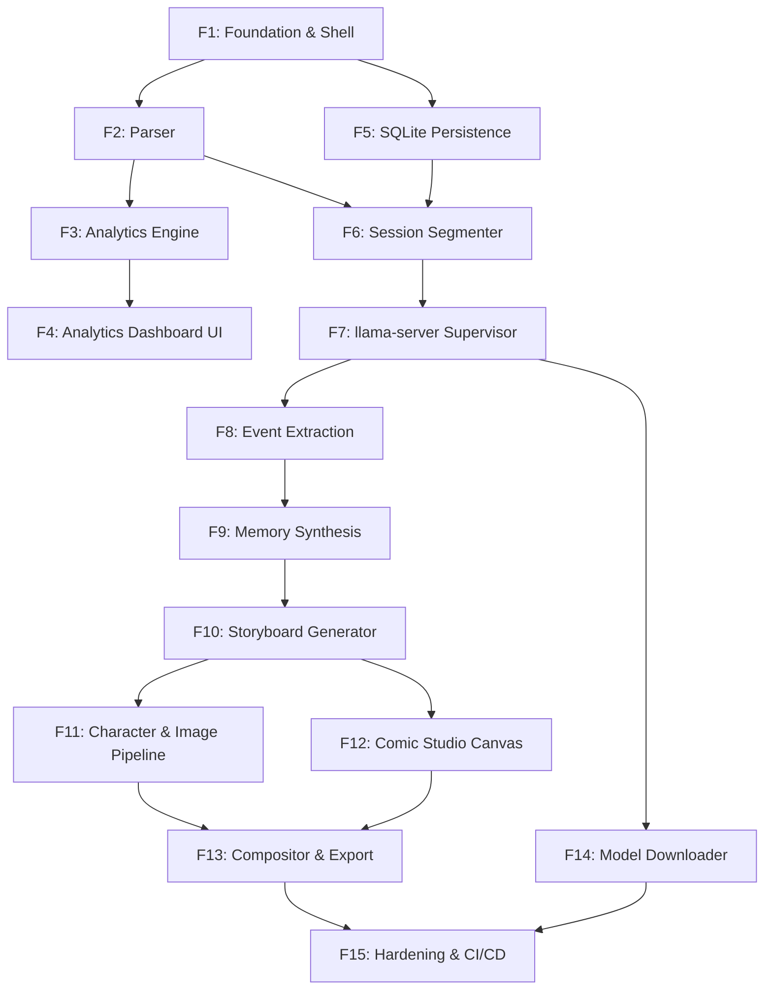

# Yapbook — Master Roadmap

> Full project build order. This document describes **what** needs to be built and **why**, in dependency order. It is not a rigid specification — it introduces the problem, states the requirements, presents the recommended approach alongside alternatives, and defines how to verify the result.
>
> For implementation specifics, see the individual track docs:
> - [Priyanshu's Track](priyanshu/milestones.md) — Core engine, Rust, SQLite, inference, persistence, compositor
> - [Ashwani's Track](ashwani/milestones.md) — Frontend, UI/UX, Studio Canvas, & Image Generation Pipeline

---

## Progress Tracker

```
[ ] Feature 1  — Foundation & Tauri v2 Shell                          (Sprint 1)
[ ] Feature 2  — Streaming WhatsApp Parser                            (Sprint 1)
[ ] Feature 3  — Statistical Analytics Engine                         (Sprint 1)
[ ] Feature 4  — Analytics Dashboard UI                               (Sprint 1)
[ ] Feature 5  — SQLite WAL Persistence & Database Actor              (Sprint 2)
[ ] Feature 6  — Session Segmenter & Signal Gate                      (Sprint 2)
[ ] Feature 7  — llama-server Sidecar Supervisor                      (Sprint 2)
[ ] Feature 8  — Event Extraction & Provenance Validation             (Sprint 3)
[ ] Feature 9  — Memory Synthesis                                     (Sprint 3)
[ ] Feature 10 — Storyboard Script Generator                          (Sprint 3)
[ ] Feature 11 — Character Bootstrapping & Image Pipeline             (Sprint 4)
[ ] Feature 12 — Comic Studio Canvas                                  (Sprint 4)
[ ] Feature 13 — Compositor & High-Res Export                         (Sprint 4)
[ ] Feature 14 — Model Download Manager & Onboarding                  (Sprint 5)
[ ] Feature 15 — Hardening & Multi-Platform CI/CD                     (Sprint 5)
```

---

## Dependency Graph

Features are ordered so that each feature's inputs are produced by features above it. The frontend track runs in parallel using mock data fixtures until backend contracts are ready. The shared type contracts between the tracks are defined in [contracts.md](contracts.md).



---

## Waterfall Decisions (Made Once, Inherited by Everything)

These are the high-level architectural choices that every feature inherits. They are documented in detail in [architecture.md](architecture.md) and recorded ADR-style in the [Decision Log](decisions.md). Changing any of these is a project-wide event.

| Decision | Choice | Main Alternative Rejected | Rationale |
| :--- | :--- | :--- | :--- |
| Desktop framework | Tauri v2 | Electron | 20 MB vs 150 MB+; capability-based security for private chat data |
| Core language | Rust (Tokio) | Go, Python | Native OS supervision + SQLite + child process management without a runtime |
| Frontend | React 19 + Vite + TailwindCSS | SvelteKit, Vue | Component ecosystem, dev velocity, team familiarity |
| Persistence | SQLite WAL + Single Writer Actor | PostgreSQL, IndexedDB | Single-file, portable, crash-recoverable; no server process |
| LLM inference | `llama-server` (llama.cpp) sidecar | Ollama, Python `transformers` | Model-agnostic GGUF, configurable GPU offload, standalone binary |
| Image generation (v1) | Cloud API with anonymization | Local-only diffusion | Lower hardware barrier; privacy maintained via pre-flight scrubbing |
| Contracts | Manually authored shared TS + Rust types | Code generation (protobuf, OpenAPI) | Two-person team; codegen overhead > manual sync overhead |

---

## Feature 1 — Foundation & Tauri v2 Shell

### The Problem

Every subsequent feature needs a running desktop application with two-way communication between a React frontend and a Rust backend. Without this foundation, nothing else can be built or tested.

### Requirements

- Tauri v2 project structure scaffolded and building cleanly
- Async Tokio runtime configured in Rust
- At least one IPC round-trip working (frontend calls Rust, gets a typed response)
- Custom frameless window with drag, minimize, maximize, close
- React + Vite + TailwindCSS hot-reloading in the Webview
- Global error type (`AppError`) defined in Rust with serde serialization for IPC

### Recommended Approach

Use `cargo tauri init` to scaffold the project. Configure Tauri v2 capabilities for shell subprocess spawning and app-data filesystem access (needed later for `llama-server` and SQLite). Set up Tokio multi-threaded runtime. Implement a `ping → pong` IPC command as a smoke test. Frontend scaffold: layout shell with Titlebar, Sidebar, Viewport, StatusBar.

### Alternatives to Consider

| Choice | Option A | Option B |
| :--- | :--- | :--- |
| Window styling | Native OS titlebar (zero effort) | Custom frameless (more polished, more work) |
| Frontend bundler | Webpack (more mature) | Vite (faster HMR, less config) |
| State management | Redux (heavy but proven) | Zustand (minimal boilerplate, fast selectors) |

### Verification

- `cargo tauri dev` launches with HMR
- IPC round-trip: `invoke("ping")` returns `"pong"` in the frontend console
- Window drag, minimize, maximize, close all work

---

## Feature 2 — Streaming WhatsApp Parser

### The Problem

WhatsApp chat exports can contain 100 K+ messages in a single `.txt` file. Naively loading everything into memory wastes RAM and blocks the UI. We need a parser that streams messages one-by-one and feeds multiple downstream consumers simultaneously.

### Requirements

- Parse both Android and iOS WhatsApp export formats
- Handle multiline messages (poetry, code blocks, long rants)
- Handle narrow no-break space (`\u202F`) in 12-hour timestamps
- Strip `@mention` Unicode isolate tags (`\u2066-\u2069`)
- Classify message types: text, system, deleted, link, media omitted
- Keep memory footprint < 10 MB even on million-message files
- Feed parsed messages simultaneously into persistence, analytics, and session sinks

### Recommended Approach

Implement `WhatsAppParser<R: BufRead>` as a Rust `Iterator` that yields `Result<Message, ParseError>`. Use `BufReader` for streaming I/O. Use `tokio::task::spawn_blocking` to keep the async runtime responsive. Multi-sink fan-out: as messages yield, pipe into the DB writer actor (batched), analytics accumulator (single-pass), and session segmenter concurrently.

The parser computes `estimated_tokens = char_count / 4.0` as a rough heuristic. This is sufficient for priority sorting but not accurate for Hinglish/Devanagari text — see [processing-times.md](processing-times.md) for empirical token measurements.

### Alternatives to Consider

| Choice | Option A | Option B |
| :--- | :--- | :--- |
| File loading | `read_to_string` (simple, high RAM) | `BufReader` iterator (streaming, low RAM) |
| Date parsing | Hardcoded format strings | Heuristic regex auto-detection |
| Regex execution | Sync on calling thread | `spawn_blocking` to avoid stalling IPC |

### Verification

- Ingests the benchmark file (137 k lines → ~126 k messages) with 0 parse errors
- Completes in < 2 s in release mode
- Peak memory stays < 10 MB (measure with a profiler or `/proc/self/status`)

---

## Feature 3 — Statistical Analytics Engine

### The Problem

Users want instant insight into their group chat dynamics — who talks the most, when the group is active, who talks to whom. These metrics must be computed deterministically (no LLM), fast, and in a single pass so they're ready immediately after parsing.

### Requirements

- Compute 15 metric categories in a single O(N) pass: volume distributions, temporal heatmaps (7×24), member participation, directional reply matrices, vocabulary frequencies, milestones
- Emit a strongly-typed `AnalyticsReport` struct/interface consumable by the frontend
- Complete in < 500 ms for 126 K messages

### Recommended Approach

Single-pass accumulator pattern: iterate over all messages once, updating HashMaps, counters, and bitsets for each metric category simultaneously. Reply detection: if the previous message is from a different sender and within 3 minutes, count it as a reply for the directional matrix.

### Alternatives to Consider

| Choice | Option A | Option B |
| :--- | :--- | :--- |
| Architecture | Multi-pass filters (simpler logic) | Single-pass accumulators (one iteration, all metrics) |
| Reply detection | Explicit WhatsApp reply metadata | Time-window heuristic (3 min, different sender) |
| Stopword filtering | Hardcoded array | Static `HashSet` / `phf::Set` for O(1) lookup |

### Verification

- Unit test results match the pre-computed `benchmarks/chat-stats/report.json` exactly
- Execution completes in < 500 ms for the benchmark dataset

---

## Feature 4 — Analytics Dashboard UI

### The Problem

The analytics data from Feature 3 needs to be visualized in a way that's immediately engaging — interactive charts, heatmaps, leaderboards. This is the first thing the user sees after importing a chat, so it needs to feel polished and responsive.

### Requirements

- Render interactive volume timeline, 7×24 activity heatmap, member contribution rankings, directional reply matrix, and milestones
- 60 FPS interactions: hover tooltips, tab switching, chart animations
- Work in standalone browser mode (`pnpm run dev`) using mock data from `report.json` — no Rust backend required for development

### Recommended Approach

Build a tabbed dashboard with 4–5 views (Overview, Members, Activity Heatmap, Social Graph, Milestones). Use Chart.js or Recharts for Canvas-based chart rendering (handles 365-day timelines without DOM bloat). Load analytics data from Zustand store, which can be hydrated from either real IPC or mock JSON.

### Alternatives to Consider

| Choice | Option A | Option B |
| :--- | :--- | :--- |
| Chart rendering | D3.js (maximum flexibility, steep learning curve) | Chart.js / Recharts (Canvas-based, simpler API) |
| Heatmap | Canvas 2D render | Grid of styled Tailwind elements (crisper CSS tooltips) |
| Data source in dev | Require Rust backend running | Mock switcher loading `report.json` |

### Verification

- All chart components render with the benchmark dataset loaded from mock JSON
- Tab switching is instantaneous
- Hover tooltips display correct values matching the source data

---

## Feature 5 — SQLite WAL Persistence & Database Actor

### The Problem

All pipeline state — messages, sessions, events, jobs, storyboards — needs to survive app crashes and restarts. SQLite is the durability layer. But naively writing from multiple async tasks causes `SQLITE_BUSY` lock contention. We need a concurrency pattern that handles high-throughput writes without blocking reads or the UI.

### Requirements

- SQLite in WAL mode for concurrent readers + single writer
- A dedicated Database Writer Actor consuming from a Tokio MPSC channel — all writes go through this actor
- Independent read connections for UI queries (never block on writes)
- Tiered commit policies: high-throughput batch writes for ingestion, immediate commits for job state transitions (see [architecture.md](architecture.md#54-tiered-database-commit-policy))
- Crash recovery on startup: detect jobs left in `running` state and mark them `orphaned`
- Schema migration system with version tracking

### Recommended Approach

Single `DbWriterActor` task on a dedicated Tokio spawn, receiving `DbCommand` variants over `tokio::sync::mpsc`. Each command type carries its own commit policy (batch size, `PRAGMA synchronous` level). Read connections are opened independently and handed to query handlers. On startup, run `UPDATE jobs SET status='orphaned' WHERE status='running'` to clean up interrupted jobs.

### Alternatives to Consider

| Choice | Option A | Option B |
| :--- | :--- | :--- |
| Write concurrency | Connection pool with mutex | Single Writer Actor (eliminates lock contention entirely) |
| Commit policy | One-size-fits-all `FULL` sync | Tiered per data type (throughput vs durability tradeoff) |
| Migration system | Manual SQL scripts | Migration runner with `schema_version` table |

### Verification

- Concurrently spawn 10+ background tasks writing 1,000 records each — 0 lock errors, 100 % committed rows
- Kill the process mid-write, restart — orphaned jobs detected and recovered
- Read queries during active writes return results without blocking

---

## Feature 6 — Session Segmenter & Signal Gate

### The Problem

Sending every conversation burst to the LLM is wasteful. Many sessions are just 2–3 emoji exchanges or "ok" replies. We need to segment the chat stream into discrete conversational episodes, then score each one to decide whether it's worth the cost of LLM extraction.

### Dependencies

- Feature 2 (Parser — produces the message stream)
- Feature 5 (SQLite — persists the sessions)

### Requirements

- Segment messages into sessions using a 30-minute inactivity gap
- Score each session with a richness formula that rewards both multi-party banter and long monologues
- Avoid divide-by-zero on sub-minute bursts
- Flag ~42 % of sessions as low-signal (matching benchmark data)
- Persist sessions to SQLite with `is_high_signal` flag
- Expose sessions via IPC for frontend inspection

### Recommended Approach

Linear scan over chronologically sorted messages. When `gap > 30 min`, close the current session and start a new one. Score each session:

**Score** = (MessageCount × AvgWords × (1.0 + ln(Participants)) × MonologueBonus) / max(DurationMins, 1.0)

**MonologueBonus** = 1.5 if a single sender has ≥ 5 messages with ≥ 10 avg words, else 1.0. Threshold: `Count ≥ 5 AND Score ≥ P25(all scores)`.

### Alternatives to Consider

| Choice | Option A | Option B |
| :--- | :--- | :--- |
| Gap threshold | Fixed 30 min | Adaptive (vary by time-of-day activity) — more complex, unclear benefit |
| Scoring formula | Simple message count filter | Richness score with monologue bonus (catches storytelling bursts) |
| Low-signal handling | Drop entirely | Fast-track with 1-line summary (preserves data, saves LLM cost) |

### Verification

- 126 K messages segment into ~1,026 sessions
- ~42 % flagged as low-signal / fast-track
- No divide-by-zero on sessions with duration < 1 minute
- Monologue sessions (single speaker, long messages) are not penalized

---

## Feature 7 — llama-server Sidecar Supervisor

### The Problem

LLM inference runs in a separate C++ process (`llama-server`). We need to manage its lifecycle reliably: detect hardware capabilities, launch with the right settings, verify health, and guarantee clean termination — even if the parent app crashes or is force-killed.

### Dependencies

- Feature 1 (Tauri — sidecar management)
- Feature 5 (SQLite — model registry persistence)

### Requirements

- Hardware capability detection: GPU vendor, VRAM, RAM, Metal/CUDA backend
- Model-agnostic `ModelManifest` system — switching models is a config change, not a code change
- Clean process lifecycle: spawn → health check → ready state → graceful shutdown
- OS-level process binding to prevent orphaned zombie processes:
  - Windows: `CreateJobObject` with `JOB_OBJECT_LIMIT_KILL_ON_JOB_CLOSE`
  - macOS / Linux: Process group via `setpgid`
- Stale PID cleanup on startup
- `llama-server --parallel N` must match the dispatcher concurrency configured in the manifest

### Recommended Approach

Implement a `Supervisor` struct in Rust that owns the child process handle. On startup: probe hardware → resolve best model from manifest → check for stale PIDs → spawn `llama-server` → poll `/health` with 60 s timeout → emit `LLM_READY` event.

### Alternatives to Consider

| Choice | Option A | Option B |
| :--- | :--- | :--- |
| LLM runner | Ollama (higher-level API, less control) | Raw `llama-server` (direct control over slots, GPU offload, context window) |
| Model definition | Hardcoded model name in code | `ModelManifest` registry (model-agnostic, swappable) |
| Health checking | Assume ready after spawn | Poll `/health` endpoint until 200 OK |

### Verification

- `llama-server` spawns and passes health check on available hardware
- Killing the Yapbook process also kills `llama-server` (no orphaned processes)
- Stale PID from a previous crash is cleaned up on restart
- `get_supervisor_status()` IPC command returns correct state

---

## Feature 8 — Event Extraction & Provenance Validation

### The Problem

High-signal sessions need to be transformed into structured events with source message provenance. The LLM proposes events and cites evidence — but the LLM can hallucinate citations. The application must independently verify every claim before committing.

### Dependencies

- Feature 6 (Sessions — provides the input)
- Feature 7 (llama-server — provides inference)

### Requirements

- Build prompts that inject the member whitelist and session messages
- Constrain LLM output via JSON Schema grammar
- Validate every `source_message_id` proposed by the model against the actual session
- Validate participant names against the member whitelist
- Support configurable concurrency (N = 1, 2, 4) matching `llama-server --parallel`
- Graceful fallback: retry with low temperature → fall back to 1-line summary → never drop data

### Recommended Approach

Prompt builder injects session messages and member whitelist. `reqwest` HTTP POST to `llama-server` `/v1/chat/completions` with JSON Schema response format. Rust-owned semantic validator checks every proposed `source_message_id` exists in the real session and every participant name matches the whitelist. On validation failure: retry once with temperature 0.1, then degrade to a deterministic 1-line summary.

### Alternatives to Consider

| Choice | Option A | Option B |
| :--- | :--- | :--- |
| Output constraining | Free-text + regex parse | JSON Schema grammar constraint (structured, fewer parse errors) |
| Provenance strategy | Trust LLM citations | Application-verified: every ID cross-checked in SQLite |
| Failure handling | Drop invalid sessions | Graceful fallback chain (retry → low-temp → 1-line summary) |

### Verification

- Create a golden evaluation fixture of 20 representative sessions
- ≥ 90 % direct valid extraction on first attempt
- 100 % of remaining edge cases trigger fallback cleanly (no dropped sessions)
- 0 committed events with invalid source message IDs

---

## Feature 9 — Memory Synthesis

### The Problem

Individual events are fragments. Users want coherent member profiles ("Priyanshu is the planner who always suggests trips"), running jokes, and relationship arcs that evolve over time. This requires processing events chronologically and building up an evolving memory state.

### Dependencies

- Feature 8 (Events — provides the input)

### Requirements

- Process events in chronological order
- Build and incrementally update: member personality profiles, communication styles, running jokes, group culture notes, relationship dynamics
- Maintain provenance links: every memory claim traces back to its source events and ultimately to source messages
- Incremental updates — don't rewrite profiles from scratch on each batch

### Recommended Approach

Sequential processing in batches of ~25 events. For each batch, provide the current memory state as context and ask the LLM to produce updates (additions, modifications) rather than full rewrites. Persist memory state to SQLite with event provenance links.

### Verification

- Completed run produces non-trivial member profiles and running jokes
- Every memory claim can be traced back to source events → source messages
- Incremental updates produce similar quality to full-rewrite (A/B test on a subset)

---

## Feature 10 — Storyboard Script Generator

### The Problem

Events need to become visual narratives — 3–6 panel comic scripts with scene descriptions, character placements, and adapted dialogue. The dialogue should feel like punchy comic speech bubbles, not raw chat transcripts.

### Dependencies

- Feature 9 (Memory — provides character profiles and context)

### Requirements

- Score and select the most dramatic/comedic/memorable events for visualization
- Generate structured storyboard: title, panels with scene descriptions, characters present, dialogue lines, visual composition notes
- Adapt raw chat dialogue into comic-appropriate speech bubble text
- Output valid JSON Schema storyboard specifications
- Save to SQLite and content-addressed artifact store

### Recommended Approach

Moment scoring algorithm that weights: multi-member presence, emotional intensity, humor potential, narrative arc quality. LLM storyboard prompt that takes a selected event + relevant member profiles and outputs a 3–6 panel comic script. Dialogue adaptation: shorten long messages, preserve the voice and energy, add visual action cues.

### Verification

- Generated storyboards are valid JSON matching the schema
- Dialogue reads naturally as comic speech — not raw chat dumps
- Panel count is within 3–6 range
- Character placements are consistent within a storyboard

---

## Feature 11 — Character Bootstrapping & Image Pipeline

### The Problem

Comic panels need consistent character visuals. A character should look the same across all panels. This requires generating a canonical reference appearance from a text description, caching it, and conditioning all subsequent generation on that reference.

### Dependencies

- Feature 10 (Storyboards — provides scene descriptions)

### Requirements

- Generate text archetypes from member profiles ("20s, messy hair, round glasses, green hoodie")
- Create 3-view turnaround reference sheets (front, 3/4, side) and cache in content-addressed store
- Condition all panel generation on cached reference sheets (IP-Adapter or prompt conditioning)
- **Privacy**: Pre-flight audit asserting 0 real names, quotes, or personal identifiers in any cloud API payload
- Cloud image API client with configurable per-run cost ceiling
- Optional VRAM handover state machine for local GPU users

### Cost Ceiling Note

A 40-panel comic with 6 character reference sheets at typical cloud pricing (~$0.04/image):

- 6 reference sheets × $0.05 = $0.30
- 40 panels × $0.04 = $1.60
- **Total: ~$1.90**

Set the default ceiling at **$3.00** per run with a user-configurable override, and display estimated cost before starting generation.

### Alternatives to Consider

| Choice | Option A | Option B |
| :--- | :--- | :--- |
| Character consistency | Prompt-only (describe appearance each time) | Reference sheet + IP-Adapter conditioning (visual anchor) |
| Image generation (v1) | Local diffusion only (high hardware barrier) | Cloud API with anonymization (accessible, privacy-maintained) |
| Privacy approach | Manual prompt review | Automated pre-flight audit (zero real names in payload) |

### Verification

- Character reference sheets are generated and cached
- Pre-flight privacy audit: automated test asserting 0 real participant names or quotes in cloud payloads
- Subsequent panels for the same character are visually consistent
- Cost ceiling is enforced (generation stops, not crashes, when exceeded)

---

## Feature 12 — Comic Studio Canvas

### The Problem

Users need to preview, customize, and interact with generated comic strips — reposition speech bubbles, edit dialogue, swap panel order, re-roll individual panels. This is the flagship interactive experience.

### Dependencies

- Feature 10 (Storyboard data — provides panel structure and dialogue)
- Can be developed in parallel using mock storyboard fixtures

### Requirements

- Responsive multi-panel canvas with pan & zoom
- Draggable SVG speech bubbles with comic-style font and pointer tails
- Inline click-to-edit dialogue editing
- Layout template selector (2×2 grid, 3-panel strip, 4-panel classic)
- Single-panel re-roll action
- 60 FPS interactions during drag, zoom, and edit
- Save layout customizations back to SQLite storyboard records

### Recommended Approach

HTML5 Web Canvas or Fabric.js for the canvas container. SVG-based speech bubbles for crisp scaling. Mock storyboard fixtures (`mock_storyboard.json` + sample panel PNGs) to unblock development before the image pipeline is ready.

### Alternatives to Consider

| Choice | Option A | Option B |
| :--- | :--- | :--- |
| Canvas library | Raw HTML5 Canvas API (full control) | Fabric.js (built-in object manipulation, drag/drop) |
| Speech bubbles | Rasterized PNG overlays | SVG vector bubbles (resolution-independent, editable) |
| Dev data source | Wait for image pipeline | Mock fixtures in `public/fixtures/` |

### Verification

- All interactions work smoothly at 60 FPS with mock data
- Dialogue edits persist after tab switching
- Layout changes reflect correctly across panel arrangements
- Works in standalone browser mode (`pnpm run dev`)

---

## Feature 13 — Compositor & High-Res Export

### The Problem

The Web Canvas preview is interactive but not print-quality. Users need to export their comic as a crisp 300 DPI PDF or PNG strip that looks good when printed or shared on social media. This export must be pixel-perfect — matching the studio preview layout.

### Dependencies

- Feature 11 (Images — provides rendered panel assets)
- Feature 12 (Studio — provides user-customized layouts)

### Requirements

- Load panel images and compose them into a grid layout in Rust
- Render speech bubbles and comic fonts onto the composite via font rasterization
- Export as high-resolution PNG strip and multi-page PDF with page numbers
- Native OS "Save File" dialog via Tauri command
- Export result matches the studio preview layout

### Recommended Approach

Rust `image` crate for raster composition. `ab_glyph` / `imageproc` for text and speech bubble rendering. Read storyboard layout from SQLite, load panel images from content-addressed store, composite, and write output.

### Verification

- Exported PNG is 300 DPI and visually matches the canvas preview
- PDF has correct page breaks, page numbers, and project title
- Export completes in < 10 seconds for a 30-panel comic

---

## Feature 14 — Model Download Manager & Onboarding

### The Problem

The LLM model file is ~4.5 GB. First-time users need a smooth download experience with pause/resume support, progress tracking, and integrity verification. The onboarding flow should also detect hardware and set appropriate defaults.

### Dependencies

- Feature 7 (Supervisor — the downloaded model is consumed by the supervisor)

### Requirements

- Hardware detection and summary display (GPU, VRAM, RAM, recommended settings)
- Resumable chunked download via `reqwest` streaming with byte-range headers
- Real-time progress events to frontend (downloaded bytes, total bytes, speed)
- Pause / resume / cancel controls
- SHA-256 checksum verification after download
- Disk space pre-check (≥ 10 GB free)
- Guided onboarding wizard UI

### Alternatives to Consider

| Choice | Option A | Option B |
| :--- | :--- | :--- |
| Download mechanism | Single HTTP GET (simpler, no resume) | Chunked streaming with byte-range resume |
| Progress feedback | Polling | Real-time IPC event stream (~200 ms intervals) |
| First-run experience | Drop user straight into the app | Multi-step wizard (hardware → download → verify → welcome) |

### Verification

- Download can be paused and resumed without data loss
- SHA-256 checksum matches after complete download
- Onboarding wizard displays accurate hardware information
- Frontend progress bar shows real-time speed and ETA

---

## Feature 15 — Hardening & Multi-Platform CI/CD

### The Problem

Before release, the application needs security auditing, telemetry boundary enforcement, and automated build pipelines that produce signed installers for Windows, macOS, and Linux.

### Dependencies

- All prior features

### Requirements

- Zero-telemetry boundary audit: no raw chat data, prompts, or memories leave the machine
- Hard kill-switch for all external network requests (Offline Mode)
- Tauri strict capability permission allowlists audited
- GitHub Actions CI/CD matrix:
  - Windows → Bundle `llama-server.exe` → Build `.msi` / `.exe`
  - macOS (Apple Silicon) → Bundle `llama-server` (Metal) → Build `.dmg`
  - Linux → Bundle `llama-server` (CUDA/Vulkan) → Build `.deb` / `AppImage`
- Automated end-to-end smoke test on CI runner

### Verification

- CI builds succeed on all three platforms
- Installed application launches and completes a basic import + analytics flow
- Offline mode: zero outbound network requests verified via packet capture or proxy
- No real chat data appears in any telemetry, crash report, or log shipped externally
